<!-- Every image in this file is generated by scripts/generate_assets.py -->

<a href="https://www.linkedin.com/in/gurbanovv"></a>


 

<picture>
  <source media="(prefers-color-scheme: dark)" srcset="assets/h-work-dark.svg" />
  
</picture>

  <a href="https://play.google.com/store/apps/details?id=tm.com.ayterek"></a>
  <a href="https://play.google.com/store/apps/details?id=com.googadev.elkitap"></a>
  <a href="https://github.com/Dadebay/my_mac_utils"></a>
  <a href="https://github.com/Dadebay/Food_delivery_alow_alow"></a>
  <a href="https://play.google.com/store/apps/details?id=com.abat"></a>
  <a href="https://play.google.com/store/apps/details?id=tm.com.atlas"></a>

<b>&nbsp;+ 10 more shipped products</b>

 

| Product | What it is | Where |
| :-- | :-- | :-- |
| **ÝAKA** | Marketplace for Turkmen collars and tailoring services | [Google Play](https://play.google.com/store/apps/details?id=com.bilermennesil.yaka) · [code](https://github.com/Dadebay/Turkmen_Collar_Selling_App) |
| **Sharafyabi** | Cosmetics e-commerce | [Google Play](https://play.google.com/store/apps/details?id=com.bilermennesil.sharafyabi) · [code](https://github.com/Dadebay/SharafYabi_Cosmetics_eCommerce) |
| **Aýterek Master** | Job board for plumbers, tutors, couriers and other pros | [Google Play](https://play.google.com/store/apps/details?id=com.ayterek.ussalar) · [code](https://github.com/Dadebay/Gyzyl_eller) |
| **UCDAÝY** | PUBG UC store with free tournaments | [code](https://github.com/Dadebay/Pubg_Tournaments_and_Selling_Accounts_app) |
| **Jaytap** | Real estate listings | [code](https://github.com/Dadebay/JayTap) |
| **Atelýam** | Tailors and fashion, app + Node backend | [code](https://github.com/Dadebay/Atelyam) |
| **Pulse** | Real-time Turkish football feed from X | [code](https://github.com/Dadebay/X_AI_uygulama) |
| **Stock Management** | Stock app + Flutter web admin for small companies | [app](https://github.com/Dadebay/Stock_managament_app) · [admin](https://github.com/Dadebay/Stock_managament_admin) |
| **Nurana Bedew** | Online pharmacy | [code](https://github.com/Dadebay/Nurana-Bedew-Online-Pharmacy) |
| **AK BULUT** | E-commerce website for the AkBulut brand | [akbulut.com.tm](https://akbulut.com.tm/) |

 

<picture>
  <source media="(prefers-color-scheme: dark)" srcset="assets/h-case-dark.svg" />
  
</picture>


<a href="https://github.com/Dadebay/AyKitap">mobile app</a> ◆
<a href="https://github.com/Dadebay/AyKitap_Backend">backend</a> ◆
<a href="https://github.com/Dadebay/AyKitap_Admin_panel">admin panel</a> ◆
<a href="https://github.com/Dadebay/AyKitap_website">website</a> ◆
<a href="https://github.com/Dadebay/sms-checking-app">sms bridge</a>

 

<picture>
  <source media="(prefers-color-scheme: dark)" srcset="assets/h-bench-dark.svg" />
  
</picture>


<a href="https://github.com/Dadebay/my_mac_utils">GlassDo</a> ◆
<a href="https://github.com/Dadebay/Mi-router-Happ-vpn-integration">HappRouter</a> ◆
<a href="https://github.com/Dadebay/Food_delivery_alow_alow">Naharym</a> ◆
<a href="https://github.com/Dadebay/Plane_track_loads">Load Control</a>

 

<picture>
  <source media="(prefers-color-scheme: dark)" srcset="assets/h-tools-dark.svg" />
  
</picture>


 

<picture>
  <source media="(prefers-color-scheme: dark)" srcset="assets/h-path-dark.svg" />
  
</picture>


 

<picture>
  <source media="(prefers-color-scheme: dark)" srcset="assets/h-talk-dark.svg" />
  
</picture>

  Open to remote product work: Flutter, native macOS / iOS, or the whole stack behind them.

  <a href="https://t.me/Gurbanov_D"></a>
  <a href="mailto:dadebaygurbanow333@gmail.com"></a>
  <a href="https://www.linkedin.com/in/gurbanovv"></a>
  <a href="https://play.google.com/store/apps/developer?id=Gurbanow"></a>

Türkmençe · Türkçe · English · Русский

 

<picture>
  <source media="(prefers-color-scheme: dark)" srcset="assets/footer-dark.svg" />
  
</picture>
